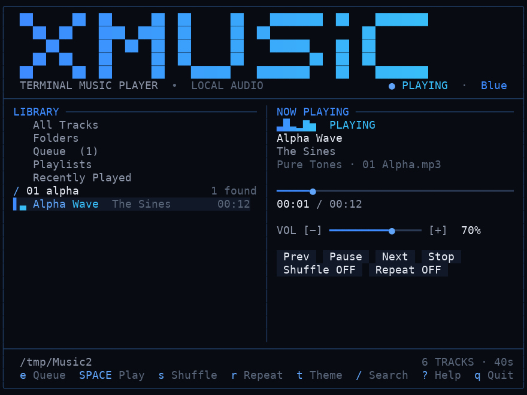
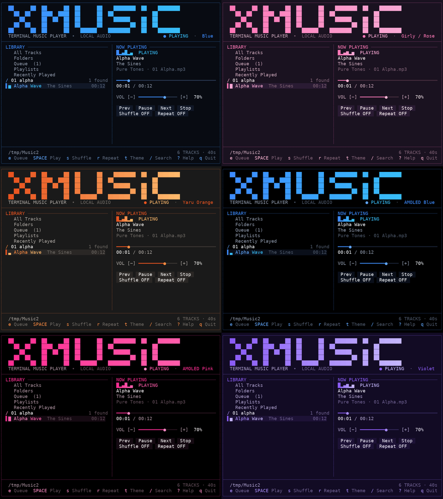
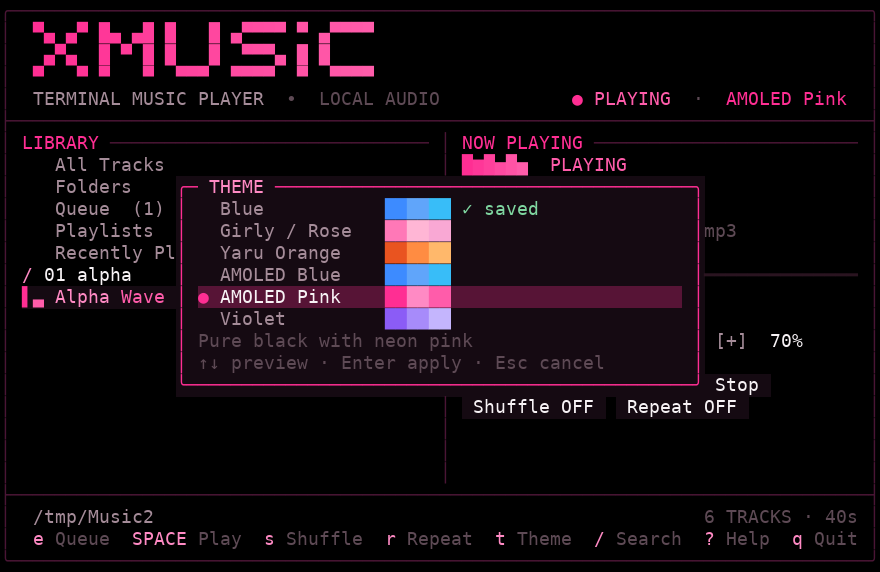

```text
██      ██  ██      ██  ██      ██    ████████  ██    ████████
  ██  ██    ████  ████  ██      ██  ██              ██
    ██      ██  ██  ██  ██      ██    ██████    ██  ██
  ██  ██    ██      ██  ██      ██          ██  ██  ██
██      ██  ██      ██    ██████    ████████    ██    ████████
```

# XMusic

**Your music. Your terminal. Your vibe.**

A lightweight, themeable terminal MP3 player for Linux, macOS and Windows. Real mouse support, six built-in
themes, queue, playlists, shuffle and repeat, subtle animations - in about 20 MB of RAM. Pure Python, two
dependencies (`miniaudio`, `mutagen`), no GUI, browser, server or telemetry.



## Features

| | |
|---|---|
| **Playback** | play/pause/stop, next/previous, seek (keys or drag the bar), volume, mute, automatic next track, streaming decode (never loads whole files) |
| **Shuffle & repeat** | real shuffle (every track once per cycle, never the same track twice in a row), repeat off / all / one |
| **Queue** | add to end, play next, remove, move up/down, clear - none of it interrupts the playing track |
| **Playlists** | create, rename, delete (with confirmation), add/remove tracks, play; stored as readable JSON |
| **Library** | recursive scan, folder browser, search (title/artist/album/filename), sort, recently played, thousands of tracks |
| **Themes** | six palettes, live preview, saved between runs, `--theme` flag, `NO_COLOR` respected |
| **Mouse** | click, double-click, wheel, drag progress/volume bars, clickable buttons, dialogs and shortcut hints |
| **Animations** | logo reveal, equalizer, track-change highlight - all optional (`--no-animation`) |

## Themes



| ID (`--theme`) | Name | Accents | Background | Text |
|---|---|---|---|---|
| `blue` | Blue | `#3D8BFF` `#60A5FA` `#38BDF8` | `#080B12` | `#E5EAF3` |
| `girly` | Girly / Rose | `#FF78B7` `#FFB6D5` `#F9A8D4` | `#1A1220` | `#FFF1F5` |
| `yaru` | Yaru Orange | `#E95420` `#FF8C42` `#FFB86B` | `#1A1A1A` | `#F2F0EE` |
| `amoled-blue` | AMOLED Blue | `#3D8BFF` `#60A5FA` `#38BDF8` | `#000000` | `#F0F4FA` |
| `amoled-pink` | AMOLED Pink | `#FF2E93` `#FF8AC4` `#FF5CAA` | `#000000` | `#F7F2F5` |
| `violet` | Violet | `#8B5CF6` `#A78BFA` `#C4B5FD` | `#120B24` | `#EFEAFB` |

Aliases accepted: `rose`/`pink` -> girly, `orange`/`ubuntu` -> yaru, `amoled` -> amoled-blue, `purple` -> violet.
The Yaru theme is only *inspired by* Ubuntu's warm orange look; it is not affiliated with or endorsed by Canonical/Ubuntu.

Press `t` to open the picker: move with the arrow keys to **preview live**, `Enter` to apply and save, `Esc` to
cancel (the previous theme returns). With the mouse: click a theme to preview, click again to apply. An unknown
saved theme silently falls back to `blue`.



## Install

Needs Python 3.9+ (developed and tested on 3.12). `miniaudio` ships prebuilt wheels for most systems; where
none exists pip compiles it, which needs a C compiler and Python headers (see *Platform status*).

### Linux (Ubuntu, Debian and others)
```bash
sudo apt install python3-venv          # only if `python3 -m venv` fails
cd XMusic                              # the unzipped / cloned folder
./install.sh                           # creates ./venv, installs deps, adds ~/.local/bin/xmusic
xmusic --music-dir ~/Music
```
Without the installer (this is the original launch command and still works):
```bash
python3 -m venv venv && ./venv/bin/pip install -r requirements.txt
./venv/bin/python xmusic.py --music-dir ~/Music
```
Audio goes through PulseAudio (PipeWire provides a PulseAudio-compatible server) or ALSA; XMusic never changes system audio settings.

### macOS
```bash
cd XMusic
./install.sh                           # same script; or the manual venv commands above
xmusic --music-dir ~/Music
```
If pip has to compile miniaudio, run `xcode-select --install` first. iTerm2 is recommended.

### Windows 10 / 11
Use **Windows Terminal** with PowerShell (Windows 10 1809+ console with ANSI support is required).
```powershell
cd XMusic
.\install.ps1                          # creates .\venv, installs deps, writes xmusic.cmd launcher
.\venv\Scripts\python.exe xmusic.py --music-dir "$env:USERPROFILE\Music"
```
Manual: `py -3 -m venv venv; .\venv\Scripts\pip install -r requirements.txt`.

### As a package (any OS)
```bash
pip install .          # provides the `xmusic` command (also: python -m xmusic_core)
```

## Quick start
```bash
xmusic --music-dir ~/Music      # first run: pick your folder; it is remembered
```
Press `Enter` on a track to play, `?` for help. If `~/Music` doesn't exist and no folder is given, XMusic asks for one.

## Controls

| Key | Action | Key | Action |
|---|---|---|---|
| `Space` | play / pause | `/` | search (typing never triggers shortcuts) |
| `Enter` | play selected / open | `o` | cycle sort: path, title, artist, album, length |
| `x` | stop | `Tab` | switch panel focus |
| `n` / `p` | next / previous (`p` restarts after 3 s) | `1`-`5`, `l`, `f` | All / Folders / Queue / Playlists / Recent |
| `<-` `->` | seek -/+ 5 s | `F5` | rescan music folder |
| `+` `-` | volume | `e` / `E` | add to queue / play next |
| `m` | mute / unmute | `d`, `Del` | remove from queue or playlist |
| `s` | shuffle on/off | `K` / `J` | move queue item up / down |
| `r` | repeat: off, all, one | `c` | clear queue (current track keeps playing) |
| `t` | theme picker | `a` / `A` | toggle Favorites / add to any playlist |
| `z` | toggle animations (saved) | `N` `R` `D` | new / rename / delete playlist |
| `?` | help | `Esc` | close dialog, clear search |
| `q`, `Ctrl+C` | quit | | |

### Shuffle, repeat, queue and playlists
* **Queue** = the list that plays next. Pressing `Enter` on a track *replaces* the queue with the list you started from
  ("play from here"); `e`/`E` add to it without replacing. Queue edits never touch the playing track; the playing item can't be removed.
* **Shuffle** reorders the *play order* only (the visible lists are never randomised). Turning it off restores the natural order. **Previous** retraces what was actually played.
* **Repeat all** wraps the queue (re-shuffling if shuffle is on); **repeat one** replays the track when it ends (Next still skips). With repeat off, playback stops at the end of the queue.
* **Playlists** live in `playlists.json`. `Favorites` always exists and can't be deleted. Entries whose file has gone are shown as *(missing)* and can be removed. The queue and recently played list persist between runs.

## Mouse support and terminal compatibility
Click rows, nav items, buttons, shortcut hints, theme names and dialog items; double-click to play; wheel scrolls lists
(elsewhere it changes volume); click or drag the progress and volume bars (seek applies on release). XMusic uses xterm
SGR mouse reporting.

| Terminal | Status |
|---|---|
| Linux terminals with xterm-style mouse (GNOME Terminal/Ptyxis/VTE, Kitty, Alacritty, WezTerm, xterm, ...) | expected to work; **only emulated in tests, not tried in each app** |
| tmux | needs `set -g mouse on` |
| macOS iTerm2 | **untested**, expected to work |
| macOS Terminal.app | **untested**; believed to lack SGR mouse mode, so use the keyboard (everything has a key) or iTerm2; 256 colours |
| Windows Terminal / modern PowerShell | **untested** (see below) |
| Old Windows console (before 1809) | unsupported: XMusic exits with a clear message |

Without mouse support the keyboard covers everything. No truecolor? XMusic uses 256 or 16 colours. `NO_COLOR` set? No colour
codes are emitted at all. Non-UTF-8 terminal or `--ascii`? Box-drawing/block glyphs are replaced by plain ASCII.

## Configuration

| File | Location |
|---|---|
| `config.json` (settings) | Linux `$XDG_CONFIG_HOME/xmusic` (`~/.config/xmusic`) - macOS `~/Library/Application Support/XMusic` - Windows `%APPDATA%\XMusic` |
| `playlists.json`, `state.json` (recent + queue) | Linux `$XDG_DATA_HOME/xmusic` (`~/.local/share/xmusic`) - macOS/Windows: same folder as config |

Set `XMUSIC_HOME` to put everything in one folder of your choice. Settings: `theme`, `volume`, `muted`, `music_dir`,
`shuffle`, `repeat`, `animation`. A malformed file never crashes the app: defaults load and the broken file is kept as `*.bad`.
XMusic 1.x playlists/recent entries stored in `config.json` are imported automatically.

**Precedence:** command line > saved settings > defaults. `--music-dir` is remembered for next time; `--theme` and
`--no-animation` apply to that launch only (change them permanently in-app with `t` / `z`).

## Command-line options
```text
xmusic [--music-dir DIR] [--theme ID] [--no-animation] [--ascii] [--version] [--help]
```
```bash
./venv/bin/python xmusic.py --music-dir ~/Music
./venv/bin/python xmusic.py --theme girly            # blue | girly | yaru | amoled-blue | amoled-pink | violet
./venv/bin/python xmusic.py --no-animation
```

## Audio formats and backend
**MP3 only** for now (decoded by `miniaudio`, tags read by `mutagen`; filename used if tags are missing). miniaudio also decodes
WAV/FLAC/Vorbis, so more formats are a small change in `library.py`, but they are not enabled or tested. Backends tried: Linux
PulseAudio/ALSA/JACK, macOS CoreAudio, Windows WASAPI/DirectSound/WinMM. If none opens, the header shows **NO AUDIO DEVICE**
and browsing still works (XMusic never silently falls back to a silent device).

**Design note (the old crash):** `TypeError: can't send non-None value to just-started generator` means the callback
generator given to `PlaybackDevice.start()` was not primed. `audio.py` primes one long-lived generator with `next()`, keeps the
callback free of I/O, and swaps tracks by replacing a small stream object. Files are validated on the UI thread before the
audio thread sees them. This is covered by regression tests.

## Performance
Measured with `tests/bench*.py` on the author's Linux sandbox: **Python 3.12.3, miniaudio's silent backend** (real decoding and
callbacks, no sound-card driver cost), 80x24 terminal, 192 kbps stereo MP3. Your numbers will differ.

| Scenario | RSS | CPU |
|---|---|---|
| Idle (6 tracks) | 19.0 MB | 0.00 % |
| Playing a 10-minute, 14 MB file - animation on | 19.7 MB | 1.5 % |
| Playing - `--no-animation` | 19.4 MB | 0.66 % |
| Paused > 2 s (audio device released) | 19.7 MB | ~0.1 % |
| 5,000-track library, idle / playing | 21.4 / 22.2 MB | 0.0 % / 1.5-2.3 % |
| 5,000 tracks: first screen / all metadata indexed | 0.09 s / 2.6 s | background |
| `xmusic --version` (non-interactive), peak | 12.2 MB | - |

How: streamed decoding with bounded buffers (a 14 MB file does not raise memory), lazy mutagen loading in idle slices, `miniaudio`
imported without its unused HTTP stack (~8 MB saved), diff-based redraws, no polling when idle, no extra threads, 8 fps only
while playing, device released when silent, C-speed volume scaling via `audioop` when available (pure-Python fallback
costs ~1.4 % more CPU). `/usr/bin/time` was not available in the sandbox, so `getrusage` was used for the peak figure.

## Platform status (honest)

| Platform | Status |
|---|---|
| **Linux (Ubuntu sandbox, Python 3.12)** | everything above was run and tested here, except audible output (no sound card) |
| **macOS** | **not run.** Shares the Linux terminal code; checked statically and by simulation only |
| **Windows** | **not run.** Separate console backend (`term_win.py`, ctypes + VT mode) checked statically only. Windows ARM64 has no prebuilt miniaudio wheel |

Wheel audit (PyPI, at build time): miniaudio has prebuilt wheels for Windows x64 (py3.12/3.13), macOS arm64, macOS Intel (older 1.61
only, py3.12) and Linux x86_64 (py3.12). **No wheel was found** for Windows ARM64, Linux aarch64 or Python 3.14 - pip builds
from source there (C compiler + headers). `audioop-lts` (Python 3.13+) has wheels for Windows, macOS and Linux x86_64. Never verified here:
audible playback on any machine, Python 3.14 runtime, `audioop-lts` code path, Ptyxis, any macOS/Windows terminal.

## Troubleshooting
* **NO AUDIO DEVICE** - no usable backend. Linux: install ALSA/PulseAudio libraries (`sudo apt install libasound2`) and check `pactl info`. Try from a normal desktop session.
* **pip fails building miniaudio** - install a C compiler and headers (`sudo apt install build-essential python3-dev`, `xcode-select --install`, or MSVC Build Tools).
* **Mouse does nothing** - see the compatibility table; tmux needs `set -g mouse on`.
* **Strange glyphs** - use a UTF-8 locale and a monospace font, or run with `--ascii`.
* **Colours wrong** - `COLORTERM=truecolor`; or unset `NO_COLOR`.
* **Terminal broken after `kill -9`** - run `reset`.
* **Red track** - it failed to decode and is skipped automatically.
* **Reset everything** - delete the config folders listed above.

## Development
```bash
python3 -m venv venv && ./venv/bin/pip install -r requirements.txt -r requirements-dev.txt
./venv/bin/python xmusic.py --music-dir /path/to/music
```

## Testing
```bash
./tests/make_test_music.sh /tmp/Music      # needs ffmpeg: tagged, corrupt, empty and garbage MP3s
mkdir -p /tmp/Music2 && cp /tmp/Music/Rock/*.mp3 /tmp/Music/Jazz/Gamma.mp3 /tmp/Music/Jazz/Live/Delta.mp3 "/tmp/Music/No Tags.mp3" /tmp/Music/Notags2.mp3 /tmp/Music2/
./venv/bin/python tests/test_core.py                        # 64 checks: queue, shuffle, repeat, playlists, config, themes, paths
./venv/bin/python tests/test_platform.py                    # 22 checks: input parser, simulated OSes, static portability scans
./venv/bin/python tests/test_engine.py /tmp/Music           # headless audio engine on miniaudio's null backend
./venv/bin/python tests/test_pty.py /tmp/Music /tmp/Music2  # 118 end-to-end checks in a pseudo-terminal (Linux/macOS)
```
Results at build time (Linux, Python 3.12): 64/64, 22/22, engine all pass, 118/118; `pyflakes` clean. The end-to-end suite uses the
null audio backend, so it proves decoding, timing, state and UI behaviour - not audible sound. The macOS/Windows rows in
`test_platform.py` are simulations. Screenshots are regenerated with `tests/make_screenshots.py` (needs `pyte`, `pillow`).

## Project structure
```text
xmusic.py               launcher (python xmusic.py ...)
pyproject.toml          package metadata, `xmusic` console script
requirements*.txt       runtime / dev dependencies
install.sh|ps1          installers (Linux+macOS / Windows)   uninstall.sh|ps1
xmusic_core/
  cli.py                argument parsing, first-run folder prompt, startup
  app.py                state, playback orchestration, input, event loop
  render.py             all drawing (reads colours only from the active theme)
  themes.py             theme registry, colour depth, NO_COLOR
  playqueue.py          queue + shuffle + repeat (pure logic)
  playlists.py          playlist JSON store
  config.py             settings + state files, validation, recovery
  paths.py              per-OS config/data directories
  audio.py              miniaudio engine (primed generator, streaming, mute, device power)
  library.py            scan + lazy ID3 metadata
  term.py / term_win.py terminal backends (POSIX / Windows) + shared input parser
  ui.py, logo.py        styled lines, overlays, ASCII fallback, wordmark
tests/                  suites, benchmarks, screenshot tooling
docs/screenshots/       real captures from the app
```
Paths use `pathlib` at the edges (config, CLI, playlists); directory scanning uses `os.scandir` for speed on large libraries.

## Contributing
See [CONTRIBUTING.md](CONTRIBUTING.md). Report which platforms you actually tested.

## License
No licence has been chosen yet, so none is included; all rights remain with the author until one is added.
